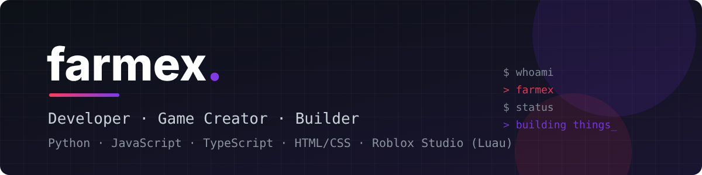

  

  

---

### 👤 About Me

- 🇹🇷 Student & self-taught developer from **Türkiye**
- 🛠️ I build **Discord bots**, **web tools**, **Python automation** and **Roblox games**
- 🎮 Roblox Studio game creator — UI systems, gameplay loops and horror-comedy projects in **Luau**
- 🖥️ Into **PC hardware**, AI tooling and digital privacy
- 📈 Currently learning: **e-commerce** and **commercial Photoshop design**

---

### 🧰 Tech Stack

  

| Area | Tools |
| --- | --- |
| **Languages** | Python · JavaScript · TypeScript · HTML/CSS · Luau |
| **Bots & Backend** | Discord.js v14 · discord.py · Node.js · Prisma · SQLite |
| **Web** | HTML/CSS/JS · Three.js · Vercel |
| **Game Dev** | Roblox Studio · Luau · UI kits · Meshy.ai (3D assets) |
| **Tools** | Git · GitHub · VS Code · Photoshop · AI coding assistants |

---

### 🚀 What I Work On

| Project | Description | Stack |
| --- | --- | --- |
| 🎫 **Ticket Bot** | Fully customizable professional Discord ticket system | TypeScript · Discord.js · Prisma |
| 📊 **Server Stats Bot** | Auto-updating stats category with live voice channels | Discord.js v14 |
| 🛒 **Marketplace Bot** | Production-grade marketplace bot for game items | Python |
| 📦 **Inventory Optimizer** | Item pricing, inventory analysis and arbitrage tooling | Python |
| 🧊 **CFOP Cube Trainer** | Rubik's Cube trainer with 3D visualizer & muscle-memory drills | HTML · CSS · JS |
| 🚽 **Restroom Rush** | Horror-comedy Roblox game with a custom UI kit | Roblox Studio · Luau |
| 🖥️ **PC AI** | Local AI assistant for PC hardware questions | Python |

---

### 📊 GitHub Stats

  

---

  

<i>“Ship it, then make it better.”</i>

